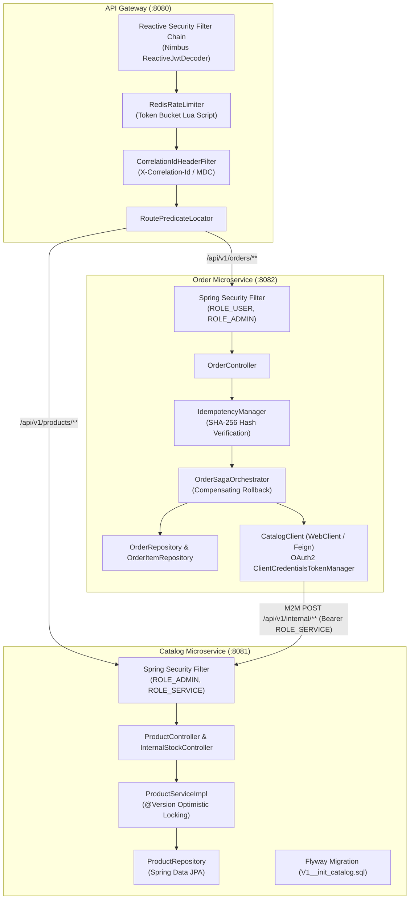
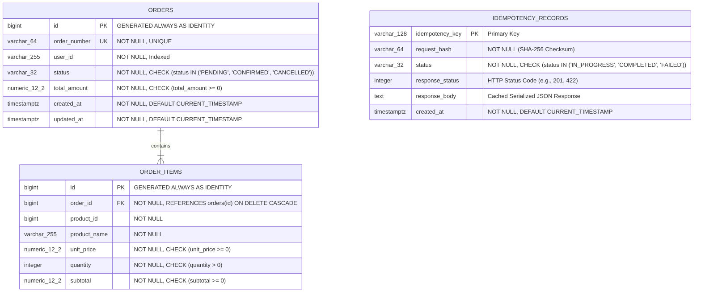

# SHOP.IO — Backend Microservices Architecture & API Specification

This document provides complete, low-level technical documentation for the backend microservices tier of **SHOP.IO**: `api-gateway`, `catalog-service`, and `order-service`.

---

## 1. Backend Architecture & Components



---

## 2. Database Architecture & ERD Diagrams

Each microservice adheres strictly to the **Database-per-Service** pattern with independent PostgreSQL instances and Flyway schema migration scripts.

### 2.1 Catalog Service Database (`catalog_db`)

```mermaid
erDiagram
    PRODUCTS {
        bigint id PK "GENERATED ALWAYS AS IDENTITY"
        varchar_255 name "NOT NULL"
        varchar_64 sku "NOT NULL, UNIQUE"
        text description "NULLABLE"
        numeric_12_2 price "NOT NULL, CHECK (price >= 0)"
        integer stock "NOT NULL, CHECK (stock >= 0)"
        bigint version "NOT NULL, DEFAULT 0 (Optimistic Lock)"
        timestamptz created_at "NOT NULL, DEFAULT CURRENT_TIMESTAMP"
        timestamptz updated_at "NOT NULL, DEFAULT CURRENT_TIMESTAMP"
    }

    FLYWAY_SCHEMA_HISTORY {
        integer installed_rank PK
        varchar version
        varchar description
        varchar type
        varchar script
        integer checksum
        varchar installed_by
        timestamp installed_on
        integer execution_time
        boolean success
    }
```



- **Optimistic Locking**: The `version` column is annotated with JPA `@Version`. Concurrent inventory deduction attempts evaluate `WHERE id = :id AND version = :version`. If another transaction updates inventory concurrently, `ObjectOptimisticLockingFailureException` is thrown and retried up to 3 times before failing safely.
- **Indices**:
  - `idx_products_sku`: B-Tree index on `sku` (enforces unique lookups in $O(\log n)$).
  - `idx_products_name`: B-Tree index supporting case-insensitive ILIKE / substring searches.

---

### 2.2 Order Service Database (`order_db`)



- **Referential Integrity**: Deletion of an `orders` record cascades automatically to all child `order_items`.
- **Idempotency Barrier**: `idempotency_records` stores the SHA-256 payload digest alongside the resulting HTTP payload and status code.

---

## 3. Comprehensive API Endpoint Reference

All endpoints conform to RESTful design standards and format error responses according to **RFC 7807 Problem Details for HTTP APIs** (`Content-Type: application/problem+json`).

### 3.1 Catalog Service Endpoints

#### 1. Browse Products
- **HTTP Method**: `GET`
- **Route**: `/api/v1/products`
- **Authentication**: None (Public)
- **Query Parameters**:
  - `query` (string, optional): Substring match on name, SKU, or description.
  - `minPrice` (number, optional): Minimum product unit price filter.
  - `maxPrice` (number, optional): Maximum product unit price filter.
  - `page` (integer, optional, default: `0`): Page index.
  - `size` (integer, optional, default: `10`): Items per page.
  - `sort` (string, optional, default: `createdAt,desc`): Property and sort direction.
- **Success Response (200 OK)**:
  ```json
  {
    "content": [
      {
        "id": 1,
        "name": "Wireless Noise-Canceling Headphones",
        "sku": "TECH-HEADPHONE-001",
        "description": "Premium over-ear headphones with active noise cancellation.",
        "price": 249.99,
        "stock": 50,
        "version": 0,
        "createdAt": "2026-10-25T20:51:39.826Z",
        "updatedAt": "2026-10-25T20:51:39.826Z"
      }
    ],
    "pageNumber": 0,
    "pageSize": 10,
    "totalElements": 1,
    "totalPages": 1,
    "last": true
  }
  ```

#### 2. Get Product By ID
- **HTTP Method**: `GET`
- **Route**: `/api/v1/products/{id}`
- **Authentication**: None (Public)
- **Path Variable**: `id` (Long, required)
- **Success Response (200 OK)**: ProductResponse JSON
- **Error Responses**:
  - `404 Not Found`:
    ```json
    {
      "type": "https://api.shop.local/errors/product-not-found",
      "title": "Product Not Found",
      "status": 404,
      "detail": "Product with ID 9999 was not found.",
      "instance": "/api/v1/products/9999",
      "errorCode": "PRODUCT_NOT_FOUND",
      "timestamp": "2026-10-25T21:00:00Z"
    }
    ```

#### 3. Get Product By SKU
- **HTTP Method**: `GET`
- **Route**: `/api/v1/products/sku/{sku}`
- **Authentication**: None (Public)
- **Path Variable**: `sku` (String, required)
- **Success Response (200 OK)**: ProductResponse JSON
- **Error Responses**: `404 Not Found`

#### 4. Create Product
- **HTTP Method**: `POST`
- **Route**: `/api/v1/products`
- **Authentication**: Bearer Token with `ROLE_ADMIN`
- **Request Headers**:
  - `Authorization: Bearer <JWT>`
  - `Content-Type: application/json`
- **Request Body**:
  ```json
  {
    "name": "Mechanical Keyboard RGB",
    "sku": "TECH-KEYBOARD-002",
    "description": "Custom mechanical gaming keyboard.",
    "price": 129.50,
    "stock": 35
  }
  ```
- **Success Response (201 Created)**:
  - Header: `Location: /api/v1/products/{id}`
  - Body: Created `ProductResponse`
- **Error Responses**:
  - `401 Unauthorized`: Missing or expired token.
  - `403 Forbidden`: Authenticated user lacks `ROLE_ADMIN`.
  - `409 Conflict`: SKU already exists.
  - `400 Bad Request`: Validation failure (e.g. negative price, blank name).

#### 5. Update Product
- **HTTP Method**: `PUT`
- **Route**: `/api/v1/products/{id}`
- **Authentication**: Bearer Token with `ROLE_ADMIN`
- **Path Variable**: `id` (Long, required)
- **Request Body**: `ProductRequest`
- **Success Response (200 OK)**: Updated `ProductResponse`
- **Error Responses**: `400 Bad Request`, `401 Unauthorized`, `403 Forbidden`, `404 Not Found`, `409 Conflict`

#### 6. Delete Product
- **HTTP Method**: `DELETE`
- **Route**: `/api/v1/products/{id}`
- **Authentication**: Bearer Token with `ROLE_ADMIN`
- **Path Variable**: `id` (Long, required)
- **Success Response (204 No Content)**
- **Error Responses**: `401 Unauthorized`, `403 Forbidden`, `404 Not Found`

#### 7. Internal Deduct Stock (M2M)
- **HTTP Method**: `POST`
- **Route**: `/api/v1/internal/products/{id}/deduct-stock`
- **Authentication**: Dedicated M2M Bearer Token with `ROLE_SERVICE`
- **Edge Rule**: Blocked at API Gateway (`403 Forbidden`)
- **Request Body**:
  ```json
  {
    "quantity": 2
  }
  ```
- **Success Response (200 OK)**:
  ```json
  {
    "id": 1,
    "name": "Wireless Noise-Canceling Headphones",
    "sku": "TECH-HEADPHONE-001",
    "stock": 48,
    "version": 1
  }
  ```
- **Error Responses**:
  - `403 Forbidden`: Token lacks `ROLE_SERVICE` (all user/admin tokens rejected).
  - `422 Unprocessable Entity`:
    ```json
    {
      "type": "https://api.shop.local/errors/insufficient-stock",
      "title": "Insufficient Stock",
      "status": 422,
      "detail": "Insufficient stock for product ID 1. Requested: 99999, Available: 48",
      "instance": "/api/v1/internal/products/1/deduct-stock",
      "errorCode": "INSUFFICIENT_STOCK",
      "timestamp": "2026-10-25T21:13:57Z"
    }
    ```

#### 8. Internal Restore Stock (Saga Compensation)
- **HTTP Method**: `POST`
- **Route**: `/api/v1/internal/products/{id}/restore-stock`
- **Authentication**: Dedicated M2M Bearer Token with `ROLE_SERVICE`
- **Edge Rule**: Blocked at API Gateway (`403 Forbidden`)
- **Request Body**:
  ```json
  {
    "quantity": 2
  }
  ```
- **Success Response (200 OK)**: Updated `ProductResponse` with incremented stock and incremented JPA version.

---

### 3.2 Order Service Endpoints

#### 9. Create Order
- **HTTP Method**: `POST`
- **Route**: `/api/v1/orders`
- **Authentication**: Bearer Token with `ROLE_USER` or `ROLE_ADMIN`
- **Request Headers**:
  - `Authorization: Bearer <JWT>`
  - `Idempotency-Key: <unique-uuid-or-string>` (Required)
  - `Content-Type: application/json`
- **Request Body**:
  ```json
  {
    "items": [
      {
        "productId": 1,
        "quantity": 2
      },
      {
        "productId": 4,
        "quantity": 1
      }
    ]
  }
  ```
- **Success Response (201 Created)**:
  - Header: `Location: /api/v1/orders/14`
  - Body:
    ```json
    {
      "id": 14,
      "orderNumber": "ORD-1792962850-9281",
      "userId": "customer",
      "status": "CONFIRMED",
      "totalAmount": 579.97,
      "items": [
        {
          "id": 28,
          "productId": 1,
          "productName": "Wireless Noise-Canceling Headphones",
          "unitPrice": 249.99,
          "quantity": 2,
          "subtotal": 499.98
        },
        {
          "id": 29,
          "productId": 4,
          "productName": "Ergonomic Wireless Mouse",
          "unitPrice": 79.99,
          "quantity": 1,
          "subtotal": 79.99
        }
      ],
      "createdAt": "2026-10-25T21:14:11.008Z",
      "updatedAt": "2026-10-25T21:14:11.103Z"
    }
    ```
- **Error Responses**:
  - `400 Bad Request`: Missing `Idempotency-Key` header or empty `items` array.
  - `401 Unauthorized`: Missing or invalid Bearer token.
  - `409 Conflict`: Concurrent request with identical `Idempotency-Key` is currently executing (`status: IN_PROGRESS`).
  - `422 Unprocessable Entity (Hash Mismatch)`:
    ```json
    {
      "type": "https://api.shop.local/errors/idempotency-conflict",
      "title": "Idempotency Payload Mismatch",
      "status": 422,
      "detail": "Request payload checksum mismatch for Idempotency-Key: order-verify-1792962850.",
      "instance": "/api/v1/orders",
      "errorCode": "IDEMPOTENCY_MISMATCH",
      "timestamp": "2026-10-25T21:14:11Z"
    }
    ```
  - `422 Unprocessable Entity (Saga Failure / Out of Stock)`:
    ```json
    {
      "type": "https://api.shop.local/errors/order-processing-failed",
      "title": "Order Processing Failed",
      "status": 422,
      "detail": "Order placement failed: Catalog stock deduction rejected: Insufficient stock for product ID 1.",
      "instance": "/api/v1/orders",
      "errorCode": "ORDER_PLACEMENT_FAILED",
      "timestamp": "2026-10-25T21:14:11Z"
    }
    ```

#### 10. List Orders
- **HTTP Method**: `GET`
- **Route**: `/api/v1/orders`
- **Authentication**: Bearer Token with `ROLE_USER` or `ROLE_ADMIN`
- **Security Scoping**:
  - `ROLE_USER`: Returns orders created by the current user only (`WHERE user_id = :currentSub`).
  - `ROLE_ADMIN`: Returns orders placed by all platform users.
- **Query Parameters**: `page`, `size`, `sort`
- **Success Response (200 OK)**: `PagedResponse<OrderResponse>`

#### 11. Get Order By ID
- **HTTP Method**: `GET`
- **Route**: `/api/v1/orders/{id}`
- **Authentication**: Bearer Token with `ROLE_USER` or `ROLE_ADMIN`
- **Path Variable**: `id` (Long, required)
- **Security Scoping**: Non-admin users attempting to access another user's order receive `403 Forbidden` or `404 Not Found`.
- **Success Response (200 OK)**: `OrderResponse` JSON

---

## 4. Comprehensive Test Case Matrix

| Test ID | Endpoint | Test Scenario | Preconditions | Input / Request | Expected Status | Expected Body / Assertions |
| :--- | :--- | :--- | :--- | :--- | :--- | :--- |
| **TC-CAT-01** | `GET /api/v1/products` | Anonymous browse catalog | None | No Auth, no query params | `200 OK` | Array of products with pagination metadata. |
| **TC-CAT-02** | `GET /api/v1/products` | Substring query filter | Seeded products | `?query=Headphones` | `200 OK` | Exactly 1 product returned (`TECH-HEADPHONE-001`). |
| **TC-CAT-03** | `GET /api/v1/products` | Price bounds filter | Seeded products | `?minPrice=100&maxPrice=300` | `200 OK` | Only products priced between \$100 and \$300. |
| **TC-CAT-04** | `GET /api/v1/products/{id}` | Get existing product | Product ID 1 exists | `GET /api/v1/products/1` | `200 OK` | `id == 1`, `sku == 'TECH-HEADPHONE-001'`. |
| **TC-CAT-05** | `GET /api/v1/products/{id}` | Get non-existent product | ID 9999 does not exist | `GET /api/v1/products/9999` | `404 Not Found` | RFC 7807 `errorCode == 'PRODUCT_NOT_FOUND'`. |
| **TC-CAT-06** | `POST /api/v1/products` | Admin creates product | Valid Admin token | Valid `ProductRequest` JSON | `201 Created` | Header `Location: /api/v1/products/{id}`. |
| **TC-CAT-07** | `POST /api/v1/products` | Customer forbidden create | Customer token | Valid `ProductRequest` JSON | `403 Forbidden` | Access Denied. |
| **TC-CAT-08** | `POST /api/v1/products` | Validation fails | Admin token | `{"price": -10}` | `400 Bad Request` | Validation error list with field name and issue. |
| **TC-CAT-09** | `POST /api/v1/products` | Duplicate SKU | Admin token | Duplicate SKU | `409 Conflict` | `errorCode == 'SKU_ALREADY_EXISTS'`. |
| **TC-INT-01** | `POST /api/v1/internal/**` | Edge gateway blocks internal | Gateway route | Anonymous request | `401 / 403` | Edge block filter drops request. |
| **TC-INT-02** | `POST /api/v1/internal/**` | End-user token rejected | Direct catalog | Customer/Admin Bearer token | `403 Forbidden` | Requires `ROLE_SERVICE`. |
| **TC-INT-03** | `POST /api/v1/internal/.../deduct` | Service token deducts stock | Client creds token | `{"quantity": 1}` | `200 OK` | Stock decremented by 1, version incremented. |
| **TC-INT-04** | `POST /api/v1/internal/.../deduct` | Insufficient stock deduction | Client creds token | `{"quantity": 99999}` | `422 Unprocessable` | RFC 7807 `errorCode == 'INSUFFICIENT_STOCK'`. |
| **TC-INT-05** | `POST /api/v1/internal/.../restore` | Compensating stock restore | Client creds token | `{"quantity": 1}` | `200 OK` | Stock incremented back to original level. |
| **TC-ORD-01** | `POST /api/v1/orders` | Missing Idempotency Key | Customer token | Valid order payload | `400 Bad Request` | Missing header `Idempotency-Key`. |
| **TC-ORD-02** | `POST /api/v1/orders` | Successful order placement | Customer token | New key + available stock | `201 Created` | Order status `CONFIRMED`, stock reduced in catalog. |
| **TC-ORD-03** | `POST /api/v1/orders` | Idempotent cached replay | Customer token | Same key + identical payload | `201 Created` | Identical order response returned from DB cache. |
| **TC-ORD-04** | `POST /api/v1/orders` | Idempotency payload mismatch | Customer token | Same key + modified payload | `422 Unprocessable` | RFC 7807 `errorCode == 'IDEMPOTENCY_MISMATCH'`. |
| **TC-ORD-05** | `POST /api/v1/orders` | Saga compensation on failure | Customer token | New key + excess quantity | `422 Unprocessable` | Order marked `CANCELLED`; prior items restored. |
| **TC-ORD-06** | `GET /api/v1/orders` | Customer order isolation | Customer token | `GET /api/v1/orders` | `200 OK` | Only orders matching `userId == 'customer'`. |
| **TC-ORD-07** | `GET /api/v1/orders` | Admin global view | Admin token | `GET /api/v1/orders` | `200 OK` | Orders from all platform users returned. |
| **TC-RAT-01** | `GET /api/v1/products` | Redis rate limiter burst | Gateway route | Rapid 45+ burst requests | `429 Too Many Req` | Token bucket depleted; returns `429`. |

---

## 5. Quality Engineering & CI Verification

1. **Spotless Format Enforcer**:
   - Google Java Style formatting enforced across all modules via `mvn spotless:check`.
2. **JaCoCo Coverage Gates**:
   - Enforces $\ge 80\%$ line coverage across `catalog-service` and `order-service`. Build fails if coverage dips below threshold:
   ```xml
   <rule>
       <element>BUNDLE</element>
       <limits>
           <limit>
               <counter>LINE</counter>
               <value>COVEREDRATIO</value>
               <minimum>0.80</minimum>
           </limit>
       </limits>
   </rule>
   ```
3. **Consumer-Driven Contract Testing**:
   - `OrderConsumerContractTest` verifies `order-service` expectations against catalog contracts using Spring Cloud Contract / Pact, ensuring zero broken service-to-service interfaces before deployment.
