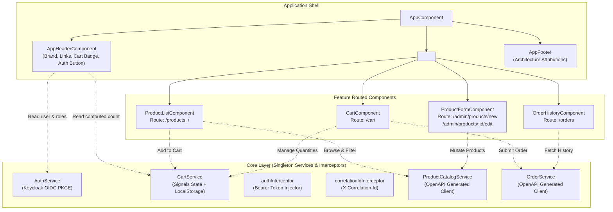
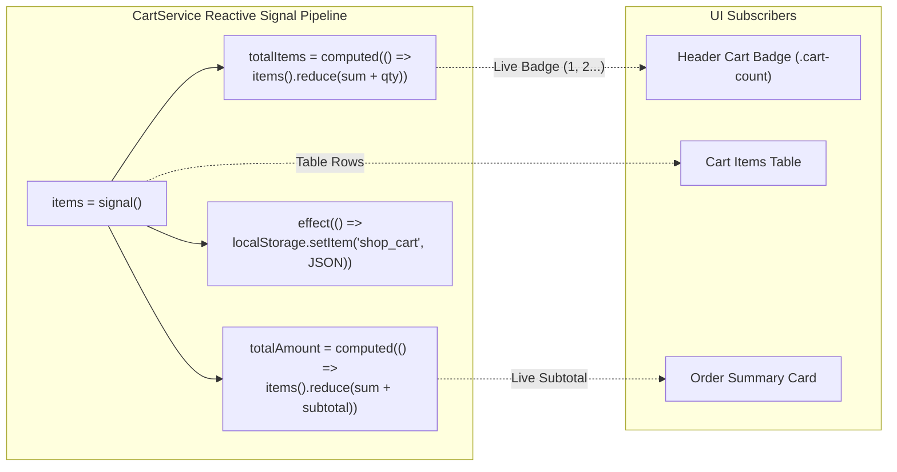
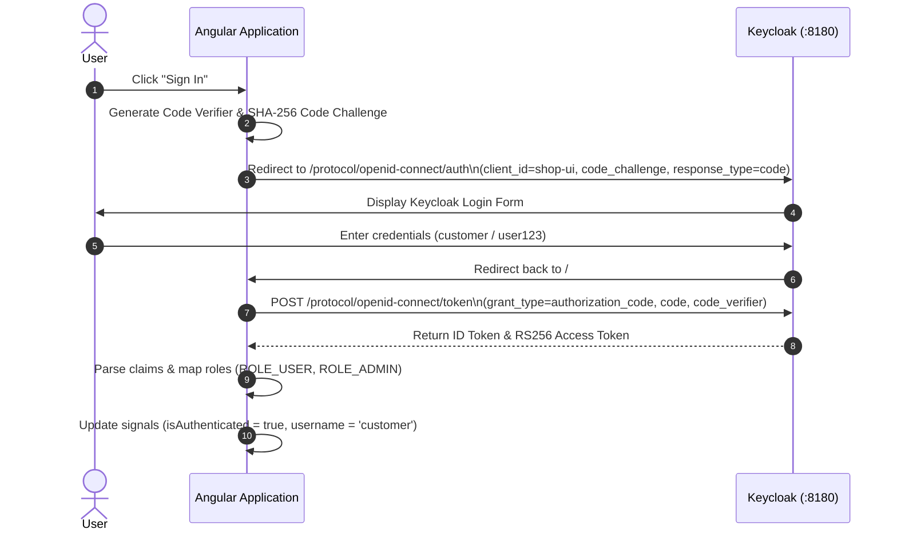
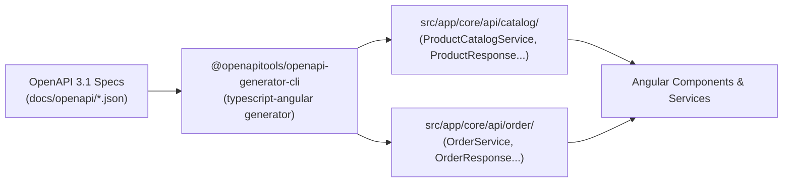

# SHOP.IO — Frontend Architecture & UI Documentation

This document provides complete technical documentation for **SHOP.IO**'s frontend application (`shop-ui`), built using **Angular 19** with standalone components, Angular Signals for reactive state management, OpenAPI generated typed clients, and a custom dark-glassmorphism design system.

---

## 1. Frontend Architecture & Component Hierarchy

The frontend is structured into modular layers adhering to Angular's modern standalone architecture (zero `NgModule` boilerplate).



---

## 2. Reactive State Management (Angular Signals)

The application eliminates complex third-party state stores (e.g. NgRx) in favor of **native Angular Signals**, achieving sub-millisecond change detection with zero unnecessary component re-renders.



### Signal Implementation Example (`CartService`)
```typescript
@Injectable({ providedIn: 'root' })
export class CartService {
  readonly items = signal<CartItem[]>(this.loadFromStorage());

  readonly totalItems = computed(() =>
    this.items().reduce((total, item) => total + item.quantity, 0)
  );

  readonly totalAmount = computed(() =>
    this.items().reduce((total, item) => total + (item.price * item.quantity), 0)
  );

  constructor() {
    // Automatically synchronizes cart state to LocalStorage on every mutation
    effect(() => {
      localStorage.setItem('shop_cart', JSON.stringify(this.items()));
    });
  }

  addItem(product: ProductResponse): void {
    this.items.update(currentItems => {
      const existing = currentItems.find(i => i.productId === product.id);
      if (existing) {
        return currentItems.map(i =>
          i.productId === product.id ? { ...i, quantity: i.quantity + 1 } : i
        );
      }
      return [...currentItems, {
        productId: product.id,
        name: product.name,
        sku: product.sku,
        price: product.price,
        quantity: 1
      }];
    });
  }
}
```

---

## 3. UI Views & Component Details

### 3.1 App Header (`AppHeaderComponent`)
- **Visuals**: Sticky frosted-glass panel (`backdrop-filter: blur(12px)`) with glowing lightning brand logo `⚡ SHOP.IO`.
- **Navigation Links**: Dynamic active tab indicator linking to `/products` and `/orders`.
- **Cart Badge**: Reactive badge showing total item count; hides automatically when cart is empty.
- **Identity Profile**:
  - Displays authenticated user avatar, preferred username, and active `ADMIN` badge if user has `ROLE_ADMIN`.
  - Single-click Login / Logout button triggering Keycloak PKCE flow.

### 3.2 Product Catalog (`ProductListComponent`)
- **Route**: `/` and `/products`
- **Features**:
  - Search input with debounce for keyword filtering (Name, SKU, Description).
  - Price range inputs (Min Price - Max Price).
  - "In Stock Only" boolean filter toggle.
  - Server-side pagination controls (Previous / Next / Page Indicator).
  - Stock level tags: `In Stock (N)` (Emerald), `Low Stock (N)` (Amber, $\le 5$), or `Out of Stock` (Rose).
  - Responsive Grid layout (`grid-template-columns: repeat(auto-fill, minmax(280px, 1fr))`).
  - Admin Action Buttons: Gated edit and delete buttons displayed only when `authService.isAdmin() === true`.

### 3.3 Shopping Cart (`CartComponent`)
- **Route**: `/cart`
- **Features**:
  - Product line items with individual unit price, quantity increment `[+]` and decrement `[-]` buttons, item subtotals, and remove item `[×]` button.
  - Order Summary sidebar showing calculated item totals, Free Shipping badge, and formatted checkout amount.
  - State Barrier: Displays "Sign In to Checkout" redirect button when anonymous; displays "Place Order" button with loading spinner when authenticated.
  - Generates client-side UUID for `Idempotency-Key` header before dispatching order request.

### 3.4 Product Form (`ProductFormComponent`)
- **Route**: `/admin/products/new` and `/admin/products/:id/edit`
- **Access**: Strictly guarded; redirects non-admin users to catalog.
- **Validation Rules**:
  - `name`: Required, minimum 3 characters.
  - `sku`: Required, alphanumeric with dashes, unique constraint.
  - `price`: Required, positive decimal with 2 decimal places.
  - `stock`: Required, integer $\ge 0$.

### 3.5 Order History (`OrderHistoryComponent`)
- **Route**: `/orders`
- **Features**:
  - Displays user's historical orders with status badges: `CONFIRMED` (Emerald), `PENDING` (Amber), `CANCELLED` (Rose).
  - Expandable order item cards detailing item quantities, unit prices, and overall total.

---

## 4. Keycloak OIDC Authentication with PKCE

The application implements enterprise OpenID Connect using `angular-oauth2-oidc` configured with Proof Key for Code Exchange (PKCE) to prevent authorization code injection.



### Circular Dependency Break in `authInterceptor`
To prevent the common Angular `NG0200` dependency cycle (`HttpClient -> authInterceptor -> AuthService -> OAuthService -> HttpClient`), the interceptor uses lazy injection:
```typescript
export const authInterceptor: HttpInterceptorFn = (req, next) => {
  // Never add Authorization header to Keycloak OIDC endpoints
  if (req.url.includes('/realms/shop-realm/')) {
    return next(req);
  }

  const injector = inject(Injector);
  let token: string | null = null;
  try {
    const authService = injector.get(AuthService);
    token = authService.getAccessToken();
  } catch {
    // Break circular dependency during initial DI instantiation
  }

  if (token && !req.headers.has('Authorization')) {
    const authReq = req.clone({
      setHeaders: { Authorization: `Bearer ${token}` }
    });
    return next(authReq);
  }

  return next(req);
};
```

---

## 5. OpenAPI Client Generation Workflow

All TypeScript API services and models are generated directly from checked-in OpenAPI 3.1 specifications (`docs/openapi/*.json`), guaranteeing compile-time type safety.



### Execution Commands
```bash
# Generate Catalog API Client
npm run generate:catalog

# Generate Order API Client
npm run generate:order

# Run full API generation suite
npm run generate:api
```

---

## 6. End-to-End Testing (Playwright)

The application includes an automated Playwright test suite (`e2e/shop.spec.ts`) validating end-to-end critical user journeys:

```typescript
import { test, expect } from '@playwright/test';

test.describe('Shop Application E2E Test Suite', () => {
  test('should load catalog and verify brand title', async ({ page }) => {
    await page.goto('/products');
    await expect(page.locator('.brand-name')).toContainText('SHOP.IO');
    await expect(page.locator('.page-title')).toContainText('Catalog');
  });

  test('should add product to cart and update cart badge', async ({ page }) => {
    await page.goto('/products');
    await expect(page.locator('.product-grid')).toBeVisible({ timeout: 10000 });

    // Click "Add to Cart" on first available product
    await page.locator('.btn-primary.btn-full').first().click();

    // Verify reactive cart count badge updates to 1
    await expect(page.locator('.cart-count')).toHaveText('1');

    // Navigate to cart view
    await page.click('.cart-btn');
    await expect(page).toHaveURL(/.*\/cart/);
    await expect(page.locator('.summary-title')).toHaveText('Order Summary');
  });

  test('should require authentication on checkout', async ({ page }) => {
    await page.goto('/cart');
    const signInBtn = page.locator('text=Sign In to Checkout');
    if (await signInBtn.isVisible()) {
      await expect(signInBtn).toBeEnabled();
    }
  });
});
```

---

## 7. Production Hardening & Nginx Deployment

The production image runs as an unprivileged container (`nginxinc/nginx-unprivileged:alpine`) configured with strict security headers:
```nginx
server {
    listen 4200;
    server_name localhost;
    root /usr/share/nginx/html;
    index index.html;

    # Security Headers
    add_header X-Frame-Options "DENY" always;
    add_header X-Content-Type-Options "nosniff" always;
    add_header X-XSS-Protection "1; mode=block" always;
    add_header Referrer-Policy "strict-origin-when-cross-origin" always;
    add_header Content-Security-Policy "default-src 'self'; script-src 'self' 'unsafe-inline'; style-src 'self' 'unsafe-inline' https://fonts.googleapis.com; font-src 'self' https://fonts.gstatic.com; connect-src 'self' http://localhost:8080 http://localhost:8180;" always;

    # HTML5 Single Page Application Routing Fallback
    location / {
        try_files $uri $uri/ /index.html;
    }
}
```
