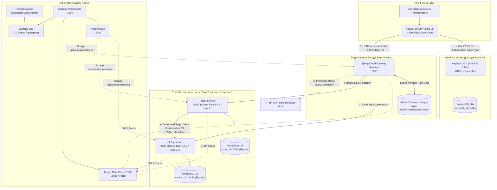
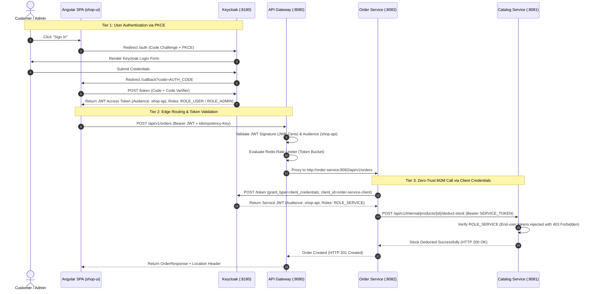
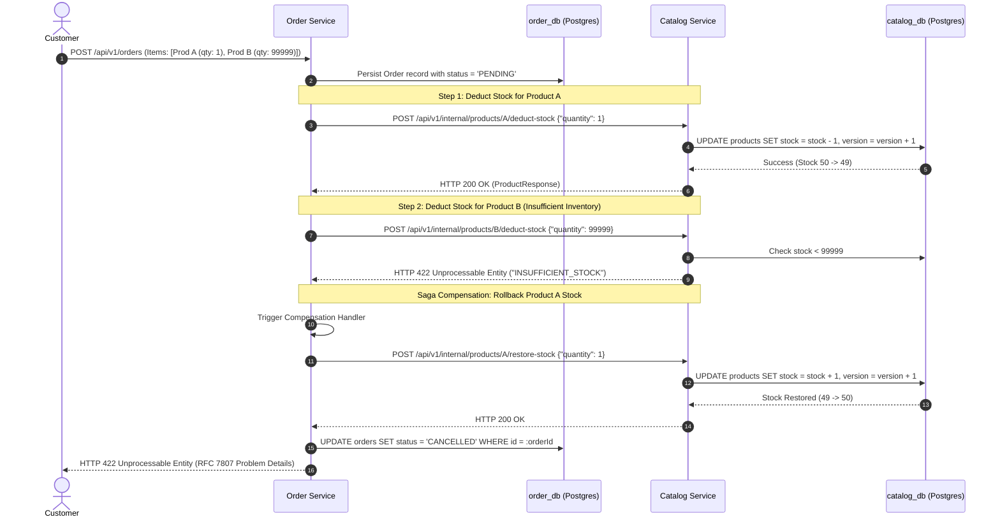
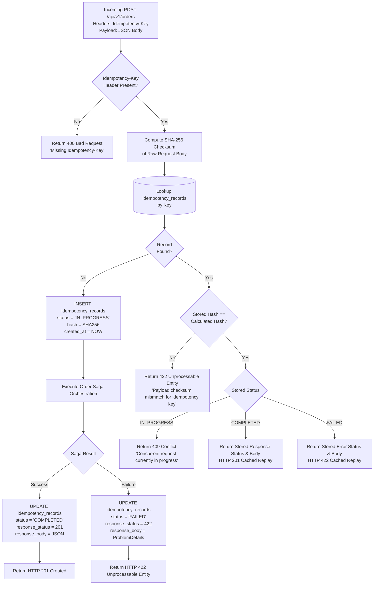
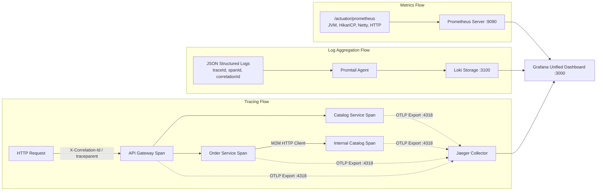

# SHOP.IO — Enterprise Microservices System Documentation

This document provides a comprehensive, production-grade system specification for the **SHOP.IO** platform. It details the overarching architectural principles, network topography, zero-trust security model, distributed transaction orchestration, high-availability data persistence, observability fabric, and containerized deployment infrastructure.

---

## 1. High-Level System Architecture

The platform is designed around a decoupled, database-per-service microservice pattern fronted by an API Gateway and authenticated via an OpenID Connect (OIDC) identity provider.



---

## 2. Global Port & Network Mapping

| Service Name | Container Name | Host Port | Internal Port | Protocol | Purpose / Access Policy |
| :--- | :--- | :--- | :--- | :--- | :--- |
| **API Gateway** | `api-gateway` | `8080` | `8080` | HTTP/1.1 | Edge entry point. Exposes public and authenticated customer/admin APIs. |
| **Catalog Service** | `catalog-service` | `8081` | `8081` | HTTP/1.1 | Product CRUD, optimistic concurrency stock management, internal M2M endpoints. |
| **Order Service** | `order-service` | `8082` | `8082` | HTTP/1.1 | Saga orchestrator, idempotent order state machine. |
| **Shop UI** | `shop-ui` | `4200` | `4200` | HTTP/1.1 | Angular 19 SPA running on hardened, unprivileged Nginx. |
| **Keycloak IAM** | `shop-keycloak` | `8180` | `8180` | HTTP/1.1 | OIDC Provider issuing signed RS256 JWT tokens with `shop-api` audience. |
| **Catalog Database** | `postgres-catalog`| `5432` | `5432` | PostgreSQL | Dedicated database for `catalog_db`. |
| **Order Database** | `postgres-order` | `5433` | `5432` | PostgreSQL | Dedicated database for `order_db`. |
| **Keycloak Database**| `postgres-keycloak`| `5434`| `5432` | PostgreSQL | Dedicated database for Keycloak identity schemas (`keycloak_db`). |
| **Redis** | `shop-redis` | `6379` | `6379` | RESP | Distributed rate limiting token bucket cache. |
| **Grafana** | `shop-grafana` | `3000` | `3000` | HTTP/1.1 | Unified dashboard for metrics, trace waterfalls, and log search. |
| **Prometheus** | `shop-prometheus` | `9090` | `9090` | HTTP/1.1 | Scrapes JVM, Spring Actuator, and host metrics. |
| **Jaeger UI** | `shop-jaeger` | `16686` | `16686` | HTTP/1.1 | Distributed trace search, span timeline visualization. |
| **Jaeger OTLP HTTP** | `shop-jaeger` | `4318` | `4318` | HTTP/1.1 | OTLP HTTP receiver for Spring Boot trace exporters. |
| **Loki** | `shop-loki` | `3100` | `3100` | HTTP/1.1 | Log storage engine queryable via LogQL. |

---

## 3. Zero-Trust Security Architecture

The platform enforces a multi-tier security perimeter combining edge blocking, public key cryptographic token verification, and machine-to-machine (M2M) role segregation.



### Security Controls & Attack Surface Reduction
1. **Edge Route Blacklisting**:
   - The Gateway contains an explicit matching rule blocking `/api/v1/internal/**` from external ingress:
   ```yaml
   - id: internal-block-catalog
     uri: no://op
     predicates:
       - Path=/api/v1/internal/**
     filters:
       - SetStatus=403
       - SetResponseHeader=X-Blocked-Reason, Internal endpoints prohibited at edge
   ```
2. **Cryptographic Audience Validation**:
   - Every microservice parses the JWT `aud` claim and rejects tokens unless `shop-api` is present, thwarting cross-realm replay attacks.
3. **Internal Endpoint Role Gates**:
   - `InternalStockController` is gated with `@PreAuthorize("hasRole('SERVICE')")`. Even if a valid Admin or Customer JWT reaches this endpoint, Spring Security enforces an immediate `403 Forbidden`.

---

## 4. Distributed Saga Pattern (Compensating Transactions)

To maintain data consistency across distributed database boundaries without blocking two-phase commits (2PC), `order-service` acts as a **Saga Orchestrator** using compensating transactions.



---

## 5. Request-Hash Idempotency Engine

To guarantee zero accidental duplicate charges or duplicate stock deductions under network packet retries, `order-service` implements an enterprise request-hash idempotency barrier.



---

## 6. Distributed Observability & Correlation

The platform provides end-to-end telemetry across asynchronous boundaries.



### Log Format Specification
All microservices emit structured single-line JSON logs via Logstash Logback encoder:
```json
{
  "@timestamp": "2026-10-25T21:14:10.905Z",
  "@version": "1",
  "message": "POST /api/v1/orders - User: customer, Idempotency-Key: order-verify-1792962850",
  "logger_name": "com.shop.order.controller.OrderController",
  "thread_name": "http-nio-8082-exec-1",
  "level": "INFO",
  "level_value": 20000,
  "appName": "order-service",
  "traceId": "045607856528409dfd12d7125e992f51",
  "spanId": "bad8c109925da4ab",
  "correlationId": "0cb7726a-46df-4e13-8fd2-9bf09ed1174d",
  "service": "order-service"
}
```

---

## 7. Deployment Architectures

### 7.1 Docker Compose (Local & Integration Testing)
The local development stack orchestrates 13 isolated containers via `deploy/docker-compose/docker-compose.yml`:
- **Mount Hardening**: Databases use host volumes; ephemeral services (`redis`, `prometheus`, `loki`, `grafana`, `keycloak`) utilize memory `tmpfs` mounts to isolate write operations from disk space bottlenecks.
- **Bootstrapping**: Automatic database initialization via Flyway migrations; realm import via Keycloak Admin REST API.

### 7.2 Kubernetes Infrastructure (`deploy/k8s`)
The production deployment manifests provide enterprise-grade hardening:
- **Namespaces**: Dedicated `shop` namespace.
- **Security Contexts**:
  - `runAsNonRoot: true`
  - `runAsUser: 10001`
  - `readOnlyRootFilesystem: true`
  - `allowPrivilegeEscalation: false`
  - `capabilities: drop: ["ALL"]`
- **Resilience & Scaling**:
  - Horizontal Pod Autoscalers (`HPA`) scaling on 75% CPU / 80% Memory thresholds.
  - PodDisruptionBudgets (`PDB`) guaranteeing `minAvailable: 1`.
  - Liveness (`/actuator/health/liveness`) and Readiness (`/actuator/health/readiness`) probes with explicit `startPeriodSeconds`.
- **Zero Real Secrets**: All manifests checked into git utilize structured placeholder values (`deploy/k8s/secrets.yaml`). Secrets are injected via SealedSecrets or Vault in production CI/CD.
